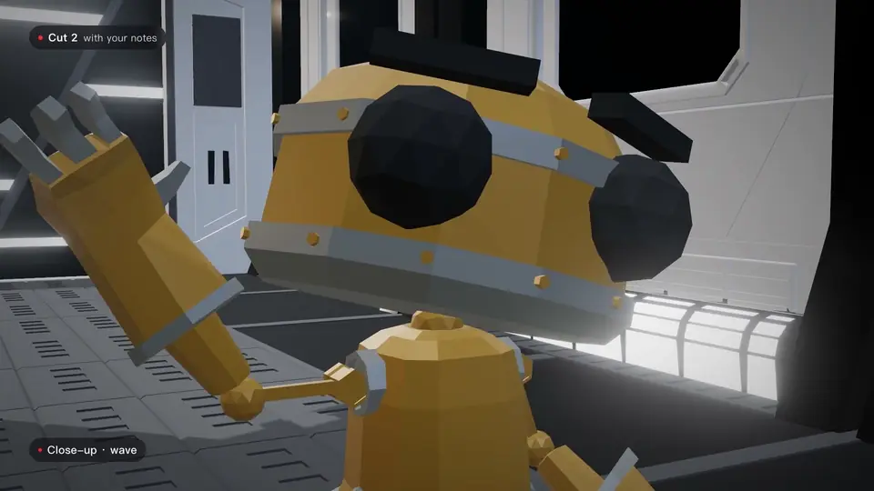
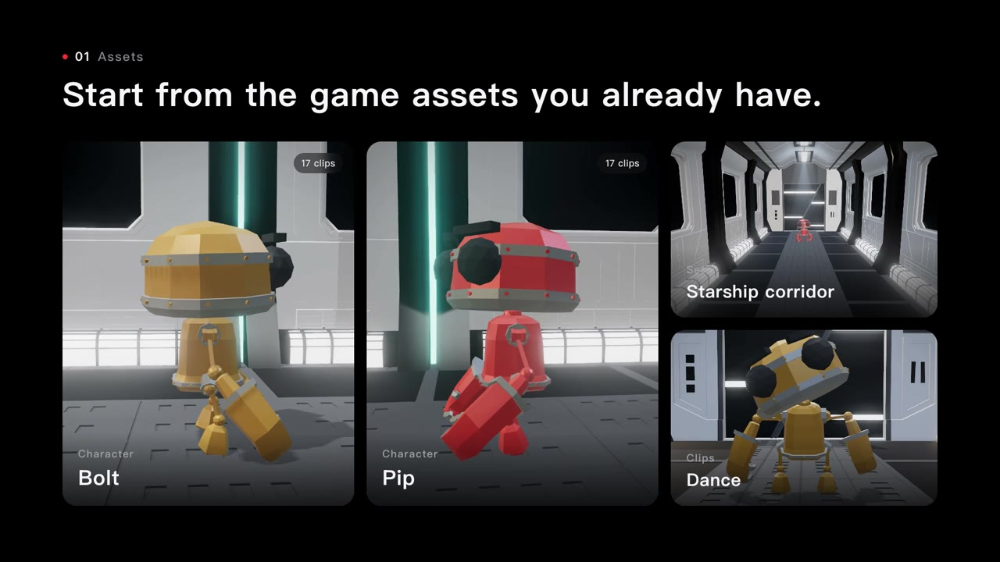
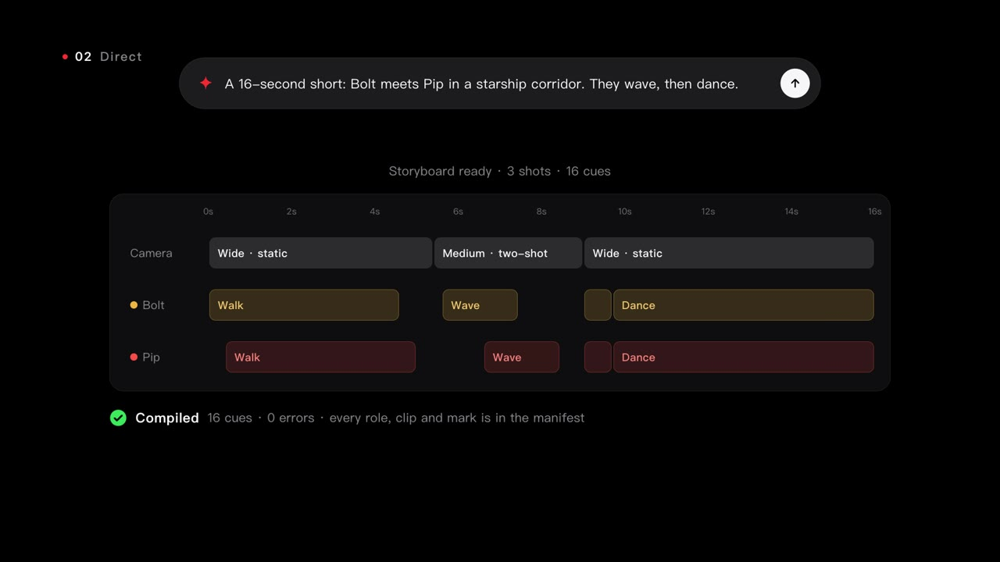
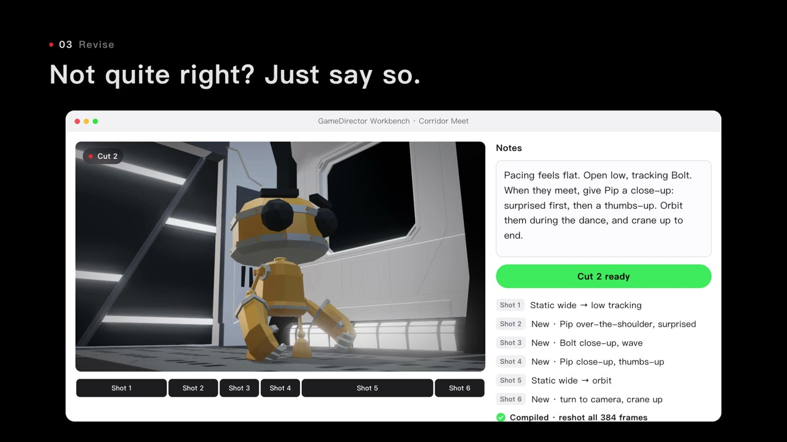

<div align="center">

# GameDirector

**让 AI 给你的游戏当导演。**

用一句话描述想要的场面，AI 把它导成分镜，<br>
游戏引擎逐帧拍出来。哪里不满意，说一句，它就重拍。

[English](../README.md) · [快速上手](#快速上手) · [接入你的 Agent](#接入你的-agent) · [文档](#更多文档)



</div>

https://github.com/user-attachments/assets/f4008315-11ab-40ab-a28e-a7e5a67bd246

<p align="center"><sub>片中每个镜头都由 AI 执导，用 GameDirector 拍摄，素材就是本仓库里的 <a href="../samples/timelines/stardeck">Stardeck 示例</a>。<br>素材：RobotExpressive（CC0，Tomás Laulhé）· Space Ship Hallway（CC BY 4.0，yeeyeeman）· 配乐："Dreaming Big"，Ahjay Stelino（Mixkit）</sub></p>

## 工作方式

| 1 · 素材 | 2 · 导演 | 3 · 修改 |
|:---:|:---:|:---:|
|  |  |  |
| 游戏先自我介绍：有哪些角色、动作、表情、道具、点位和运镜。AI 只能用片场上真有的东西。 | 说出你想要什么。AI 写出时间轴，开拍前每个角色、动作和点位都会被逐一核对。 | 用大白话提意见。AI 改时间轴，引擎重拍。 |

**AI 负责导，引擎负责拍。**

- **可复现。** 时间轴就是一个普通的 JSON 文件。再拍一次，得到的画面一模一样。可以 diff、进版本管理、手改。
- **可验证。** 游戏清单里没有的东西，开拍前就被拒掉。拍完后，`gd review` 检查构图，`gd measure` 读回每一帧的机位和角色位置。
- **可插拔。** 现在支持 Unity、Godot 和 Three.js。任何支持 MCP 的 Agent 都能来当导演。

## 引擎

|  | Unity | Godot | Three.js |
|---|---|---|---|
| 安装 | `.tgz` 包 | 插件 `.zip` | Node bridge + 适配器 |
| 拍摄 | ✅ | ✅ | ✅ |
| 编辑器面板 | Director Workbench | GameDirector 面板 | — |
| 构图检查（`gd review`） | 只看主体中心 | 逐个角色 | 逐个角色 |
| 逐帧测量（`gd measure`） | — | ✅ | ✅ |

下一个是 Unreal Engine。

## 快速上手

所有下载都在 [Releases](https://github.com/Sttrevens/GameDirector/releases) 页面。每个包都自带运行环境，不需要装 .NET、Node 或 Python。

| 你用的是 | 下载 | 大小 |
|---|---|---|
| Unity | `com.gamedirector.unity-0.1.0-<平台>.tgz` | 46–59 MB |
| Godot | `gamedirector-0.1.0-<平台>` + `gamedirector-godot-0.1.0.zip` | 50–64 MB |
| Three.js 或命令行 | `gamedirector-0.1.0-<平台>` | 50–64 MB |

平台：`win-x64`、`osx-arm64`（Apple 芯片）、`osx-x64`（Intel Mac）、`linux-x64`。在 macOS 和 Linux 上，一条命令就能下载并解压：

```bash
curl -fsSL https://github.com/Sttrevens/GameDirector/releases/download/v0.1.0/gamedirector-0.1.0-osx-arm64.tar.gz | tar -xz
```

如果是用浏览器下载的压缩包，macOS 会把解压出来的工具标记为“来自网络”，可能拒绝运行。解压后、运行任何工具之前，先执行一次 `xattr -dr com.apple.quarantine gamedirector-0.1.0-osx-arm64` 清掉这个标记。如果 macOS 已经拦过某个工具，就重新解压，先清标记再运行。

工具都在 `bin/` 目录里，不会自动加进 PATH。出片需要 FFmpeg：`bin/gd doctor` 会检查，`bin/gd media install` 会帮你装好。

这一版在 Apple 芯片的 Mac 上实测过。Windows、Linux 和 Intel Mac 的包也一起提供，测得少一些。

### Unity（2022.3 及以上）

1. 在 Package Manager 里选 **+ → Add package from tarball**，选中 `.tgz`。
2. **Window → GameDirector → Create Independent Example** 会生成一个示例场景，带角色、动画、声音和三个镜头。
3. 进入 Play Mode，打开 **Window → GameDirector → Director Workbench** 开始导演和拍摄；或者用 **Window → GameDirector → Copy MCP Config** 把片场交给你的 Agent。

### Godot（4.6 及以上）

1. 把 `gamedirector-godot-0.1.0.zip` 解压到工程里，在 **Project Settings → Plugins** 里启用 **GameDirector**。再到 **Editor → Editor Settings** 里，把 `gamedirector/gd_path` 设为下载包里的 `bin/gd`。
2. 给场景打标记：角色节点设 `gamedirector_role`，`Marker3D` 节点设 `gamedirector_location`。**GameDirector** 面板会列出它找到的一切。
3. 点 **Start bridge**，再点 **Copy MCP config**，把配置粘贴到你的 Agent 里。

完整步骤见 [Godot 指南](godot.md)，也可以直接用 [Stardeck 示例工程](../samples/godot/stardeck/README.md) 试。

### Three.js

为你的场景写一个小适配器，然后启动 bridge。[Three.js 指南](../packages/gamedirector-three/README.md) 两件事都讲了，[`adapters/stardeck`](../adapters/stardeck) 是一个能跑的例子。

## 接入你的 Agent

GameDirector 是一个 MCP 服务。把它加到 Claude Code、Cursor、Codex 或任何 MCP 客户端里：

```json
{
  "mcpServers": {
    "gamedirector": {
      "command": "<下载目录>/bin/gd",
      "args": ["mcp"],
      "env": { "GAMEDIRECTOR_ENDPOINT": "http://127.0.0.1:39779" }
    }
  }
}
```

- **Unity：** **Window → GameDirector → Copy MCP Config** 会替你复制好正确的配置。
- **Godot：** 面板上的 **Copy MCP config** 按钮复制的就是这段，端口已经填好。
- **Codex：** 同样的 command、args、env，写在 TOML 的 `mcp_servers.gamedirector` 下。

然后直接跟 Agent 说：

> *拍一段 16 秒的短片：Bolt 在星舰走廊里遇到 Pip，两人挥手，然后一起跳舞。*

想改的时候：

> *节奏太平了。开场用低机位跟着 Bolt；两人见面时给 Pip 一个特写；跳舞时镜头绕着他们转。*

想效果更好，把 [`skills/gamedirector/SKILL.md`](../skills/gamedirector/SKILL.md) 里的导演手册交给你的 Agent。

## 命令行

Agent 能做的事，都有对应的普通命令（就是下载包里的 `bin/gd`）。命令默认连 Unity 的 bridge；用 Godot 时加 `--endpoint http://127.0.0.1:39779`。

```bash
gd validate timeline.json                  # 对照运行中的游戏检查时间轴
gd take timeline.json --out take-01        # 逐帧拍摄
gd review take-01                          # 每个镜头的构图报告
gd measure timeline.json --frames 0,48 --out measure-01   # 精确的机位和角色数值
gd edit edit.json --out cut-01             # 把多条素材剪成成片
gd expect-record timeline.json --out shot.expect.json --endpoint <bridge>   # 锁定一个镜头的数值
gd expect-check  timeline.json --expect shot.expect.json --endpoint <bridge> # 发现回退
```

每条素材都附带凭据：时间轴、游戏清单、每一帧的哈希，以及编码好的 `picture.mp4`。详见 [出片流程](production.md)。

## 为什么用 GameDirector

编辑器自动化工具让 AI 实时在编辑器里点来点去。做游戏的时候很好用，但每次跑出来都不一样。GameDirector 更像一个片场：

- **AI 写的是剧本，不是鼠标操作。** 产出是一条能读、能审、能保存的时间轴。
- **片场上有什么，由游戏说了算。** 角色、动作和点位都来自游戏本身，AI 编不出不存在的东西。
- **引擎每次都按同样的方式拍，** 所以你提一条意见，只会改你想改的地方。

## 更多文档

- [导演手册](directing-playbook.md)：镜头类型、节奏和画幅
- [时间轴格式](timeline-format.md)
- [架构](architecture.md)
- [引擎契约](contract/README.md)：接入你自己的引擎
- [安装与分发](install.md)
- [更新日志](../CHANGELOG.md)

<details>
<summary><b>从源码构建</b></summary>

```bash
dotnet test
dotnet run --project src/GameDirector.Cli -- grammar     # 时间轴速查
dotnet run --project src/GameDirector.Cli -- --help
```

</details>

## 参与贡献

欢迎贡献，尤其是你自己游戏的适配器、新的镜头类型，以及引擎移植（比如 Unreal）。见 [CONTRIBUTING.md](../CONTRIBUTING.md)。

## 致谢与许可

[MIT](../LICENSE) © 2026 Sttrevens。

Stardeck 示例使用了 Tomás Laulhé 的 [RobotExpressive](../samples/assets/stardeck/ATTRIBUTION.md)（CC0）和 yeeyeeman 的 "Space ship hallway"（CC BY 4.0）。详见 [THIRD-PARTY-NOTICES](../THIRD-PARTY-NOTICES.md)。
